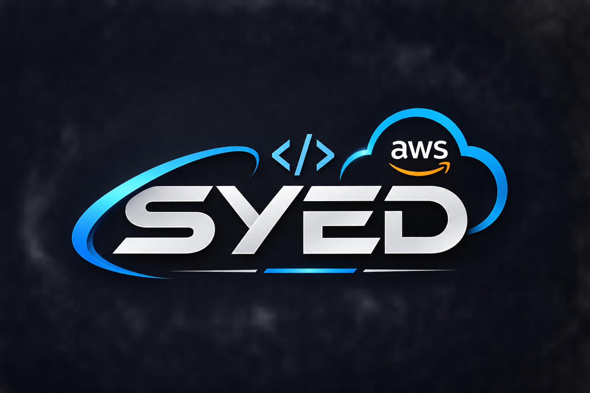
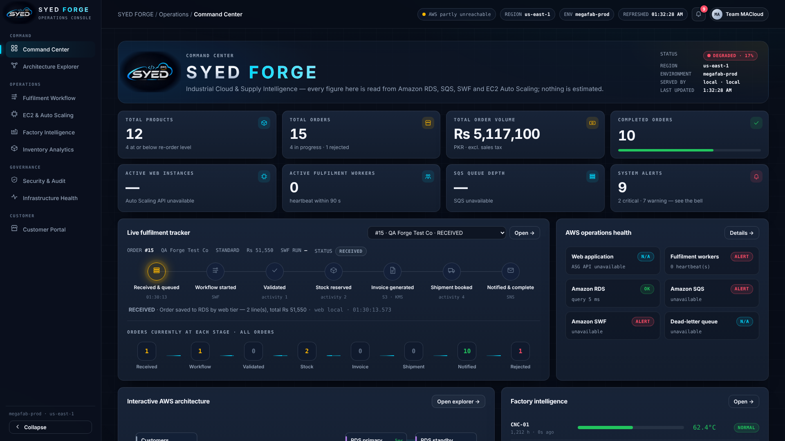
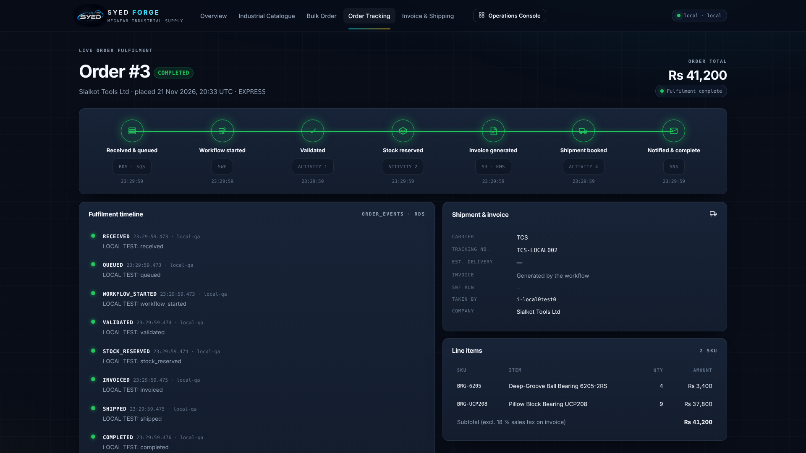
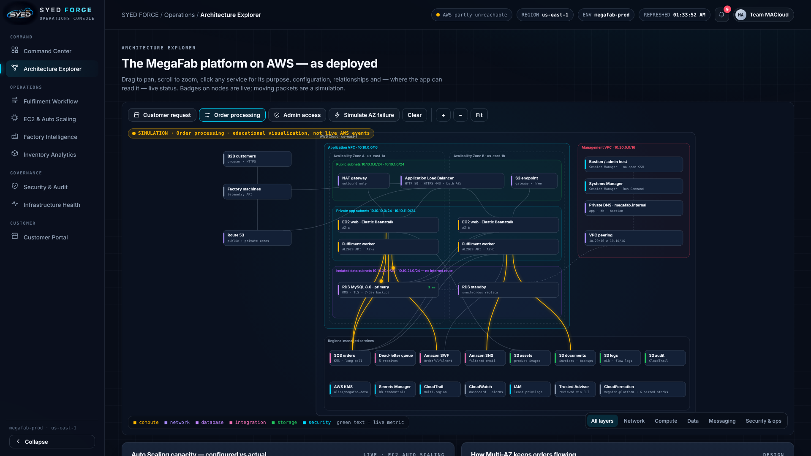
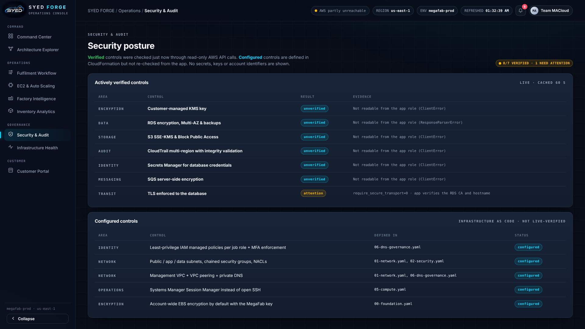
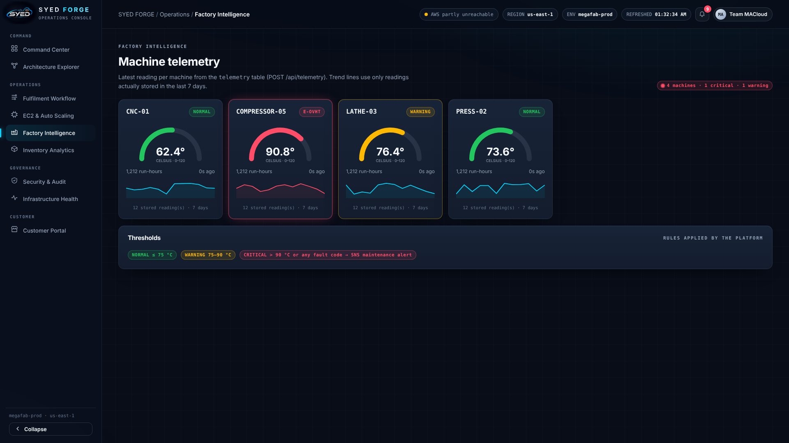

<p align="center"></p>

<h1 align="center">SYED FORGE</h1>
<p align="center"><b>Industrial Cloud &amp; Supply Intelligence</b><br><i>Engineered for Industry. Powered by AWS.</i></p>

<p align="center">


</p>

SYED FORGE is a B2B industrial supply platform (catalogue, bulk ordering, live order tracking and an operations console) built and deployed on Amazon Web Services. The business data is that of **MegaFab Industrial Supply**. An order goes from one click to delivered in about **11 seconds**. It is saved to Amazon RDS, queued in Amazon SQS, coordinated by an Amazon SWF workflow, run by EC2 Auto Scaling workers, invoiced to Amazon S3 with AWS KMS encryption, and announced through Amazon SNS.

🎥 **Demo video (720p):** [`docs/syed-forge-demo.mp4`](docs/syed-forge-demo.mp4) · **Loom walkthrough:** _add link_



## How an order flows

```
Customer ─▶ Route 53 ─▶ Application Load Balancer ─▶ EC2 web tier (Elastic Beanstalk, 2–6 instances, 2 AZs)
                                                        │  saves order to RDS MySQL (Multi-AZ, KMS, TLS)
                                                        ▼
                                                   Amazon SQS ──(DLQ after 5 tries)
                                                        ▼
                                  EC2 fulfilment workers (Auto Scaling 1–4 on queue depth)
                                                        ▼
                          Amazon SWF workflow: Validate → Reserve stock → Invoice → Ship → Notify
                                         │                 │                       │
                                      RDS MySQL     S3 invoice (SSE-KMS)      Amazon SNS email
```

| Live tracking (real order, 11 s end to end) | Interactive AWS Architecture Explorer |
|---|---|
|  |  |
| **Security: 7/7 controls verified live** | **Factory Intelligence** |
|  |  |

## Features
- **Cinematic intro and customer portal.** Industrial catalogue with live stock from RDS, instant search and category filters, and one bulk order across many products.
- **Live order tracking.** A seven-stage pipeline built from real `order_events`, with SWF run ID, worker instance, carrier, tracking number, ETA and a time-limited S3 invoice link.
- **Command Center.** Real KPIs, a live fulfilment tracker, AWS health probes, a clickable architecture map, sortable orders and an activity feed. Alerts come only from real checks.
- **Architecture Explorer.** Pan and zoom, filter by layer, click any service for its purpose, configuration and live status, and run clearly labelled simulations of request flow, order flow and an AZ failure.
- **Operations pages.** Fulfilment workflow, EC2 and Auto Scaling (configured capacity vs. actual), factory telemetry with SNS fault alerts, inventory analytics, security and audit, and infrastructure health.
- **Honest states.** "Unavailable" and "backend unreachable" states with the time of the last successful refresh. No invented numbers.

## Infrastructure as Code
`cfn/main.yaml` is the root stack. It deploys six nested stacks:

| Stack | What it builds |
|---|---|
| `00-foundation` | Customer-managed KMS key and account-wide EBS encryption |
| `01-network` | Application VPC `10.10.0.0/16` and management VPC `10.20.0.0/16`, public/app/data subnets in 2 AZs, NAT, S3 gateway endpoint, VPC peering, flow logs |
| `02-security` | Chained security groups and NACLs |
| `03-data` | RDS MySQL 8.0 (Multi-AZ, KMS, TLS-only, 7-day backups), Secrets Manager, S3 buckets (assets, docs, logs, audit) |
| `04-integration` | SQS and dead-letter queue, SNS topics with filter policies, SWF domain and types |
| `05-compute` | Elastic Beanstalk environment (ALB, 2–6 instances), worker launch template and ASG, bastion via Session Manager, CloudWatch alarms |
| `06-dns-governance` | Route 53 public and private zones, health check, CloudTrail, IAM job-role policies, CloudWatch dashboard |

## Security by design
AWS KMS encrypts RDS, S3, EBS, SQS, SNS, Secrets Manager and CloudTrail. The database requires TLS, and the app verifies the RDS CA and hostname. The DB password lives only in Secrets Manager. Instances use IAM roles and never access keys. Admin access goes through Systems Manager Session Manager instead of open SSH. CloudTrail is multi-region with log-file validation. The Security page checks these controls live through read-only API calls and never shows secrets or account identifiers.

## Repository layout
```
app/      Flask web tier: portal, ops console, read-only ops APIs, design system (static/)
worker/   SQS poller + SWF decider + SWF activities
cfn/      CloudFormation root + nested stacks
scripts/  deploy · teardown · load test · order burst · telemetry simulator · evidence
docs/     screenshots, demo video, update guide
```

## Deploy
From AWS CloudShell in `us-east-1`:
```bash
./scripts/deploy.sh you@example.com     # about 25 min; confirm the SNS subscription emails
```
To update only the web app on a running environment, see [`docs/UPDATING.md`](docs/UPDATING.md).

## Tech stack
Python 3.12 · Flask · Gunicorn · PyMySQL · boto3 · vanilla JS/CSS (no build step) · AWS Elastic Beanstalk · EC2 Auto Scaling · ALB · RDS MySQL · SQS · SWF · SNS · S3 · KMS · Secrets Manager · Route 53 · CloudFormation · CloudWatch · CloudTrail · Systems Manager

---
**Built by [Syed Measum Shah](https://github.com/syedshah7214)**. Cloud and DevOps engineer in the making.
